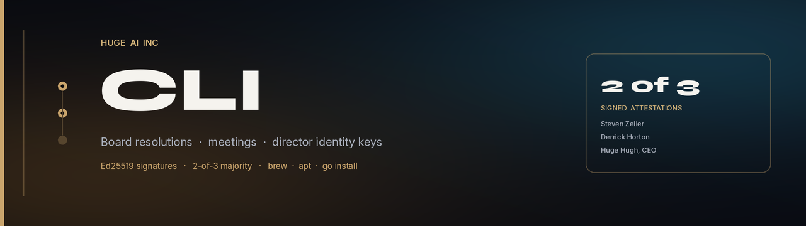
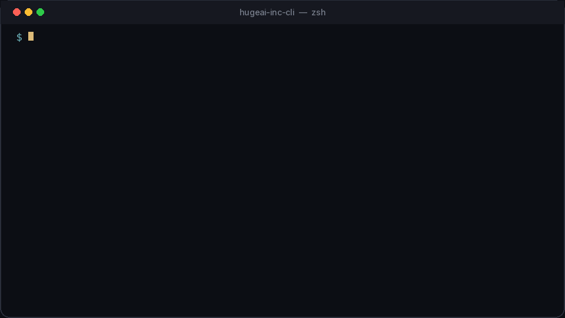

# Huge AI Inc CLI

[](https://github.com/hugeai-inc/hugeai-inc-cli/actions/workflows/ci.yml)



A Go command-line tool for Huge AI Inc board resolutions, board meetings,
and per-director Ed25519 identity keys. Directors (Steven Zeiler, Derrick
Horton, and Huge Hugh) each hold 30% voting weight; resolutions pass by a
2-of-3 majority, including CEO removal.

This repository is a **scaffold**. The command tree, install paths, and
release plumbing are in place; business logic, the Supabase client, and
real cryptographic signing are not implemented yet. Stub commands print a
short outline and `not yet implemented`.



## Install

### Homebrew

The public tap is [`hugeai-inc/homebrew-tap`](https://github.com/hugeai-inc/homebrew-tap).
Homebrew's short name for that repository is `hugeai-inc/tap`.

```sh
brew install hugeai-inc/tap/hugeai-inc-cli
hugeai-inc-cli version
```

Or:

```sh
brew tap hugeai-inc/tap
brew install hugeai-inc-cli
```

Until the first tagged release is published, install from `main`:

```sh
brew install --HEAD hugeai-inc/tap/hugeai-inc-cli
```

The formula lives at [`Formula/hugeai-inc-cli.rb`](Formula/hugeai-inc-cli.rb)
and is updated in the tap by GoReleaser on each tagged release.

### apt

`.deb` packages for `amd64` and `arm64` are built on tagged releases.
Until the GitHub Pages apt repository is published, install a release
asset directly:

```sh
# Replace VERSION and ARCH (amd64 or arm64).
curl -fsSLO "https://github.com/hugeai-inc/hugeai-inc-cli/releases/download/vVERSION/hugeai-inc-cli_VERSION_ARCH.deb"
sudo apt install ./hugeai-inc-cli_VERSION_ARCH.deb
```

Once the apt repo is live:

```sh
sudo apt install hugeai-inc-cli
```

See [`packaging/apt/README.md`](packaging/apt/README.md) for the planned
repository setup.

### go install

```sh
go install github.com/hugeai-inc/hugeai-inc-cli/cmd/hugeai-inc-cli@latest
```

## Command set

These commands are sketched stubs. Flags listed in the outlines are not
wired yet.

| Command | Purpose |
| --- | --- |
| `resolution draft` | Draft a new board resolution |
| `resolution revise` | Create a new revision linked via `supersedes_id` |
| `resolution sign` | Cryptographically sign and submit a vote (`approve` / `reject` / `abstain` / `recused`) |
| `resolution tally` | Check the vote tally and 2-of-3 majority status |
| `resolution list` | List board resolutions by status or type |
| `resolution verify` | Verify cryptographic signatures and the content hash |
| `meeting create` | Record a new board meeting |
| `meeting list` | List board meetings |
| `meeting minutes` | Show or attach signed meeting minutes |
| `keys init` | Generate a local Ed25519 identity keypair (private key stays local) |
| `keys register` | Register this director's public key |
| `keys rotate` | Self-signed rotation of the active key |
| `keys revoke` | 2-of-3 emergency revocation and key recovery |
| `keys list` (`keys status`) | List director keys and their status |
| `version` | Print the build version |

```sh
hugeai-inc-cli --help
hugeai-inc-cli resolution draft --title "Appoint Huge Hugh as CEO"
hugeai-inc-cli resolution sign --id HR-2026-001 --vote approve
hugeai-inc-cli resolution tally --id HR-2026-001
hugeai-inc-cli resolution verify --id HR-2026-001
hugeai-inc-cli keys status
```

## Signing model (sketch)

- Each director has at most one **active** Ed25519 public key on file.
  Private keys never enter the server.
- Opening a resolution for signature hashes and **locks** the canonical
  markdown. Edits create a new revision via `supersedes_id`.
- Each director signs `{resolution_id, content_hash, vote, member_id, key_id, timestamp}`
  and submits the signature for verification.
- Two distinct active directors voting `approve` adopts the resolution,
  including `ceo_removal` and `key_recovery`. Routine key rotation is
  self-signed by the current active key.

## Release packaging

- CI (`.github/workflows/ci.yml`) runs `go test ./...`, `go vet ./...`,
  and cross-compiles for `darwin/amd64`, `darwin/arm64`, `linux/amd64`,
  and `linux/arm64` on `ubuntu-latest`.
- Tagged releases (`v*`) are built by GoReleaser
  (`.github/workflows/release.yml`, `.goreleaser.yaml`): tarballs,
  `SHA256SUMS`, `.deb` packages, and a Homebrew formula pushed to
  `hugeai-inc/homebrew-tap` when `HOMEBREW_TAP_TOKEN` is set.

## License

[MIT](LICENSE) © 2026 Huge AI Inc.
